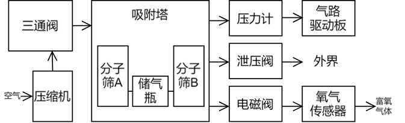
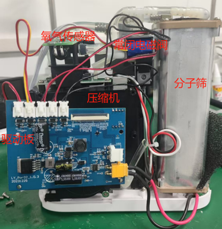
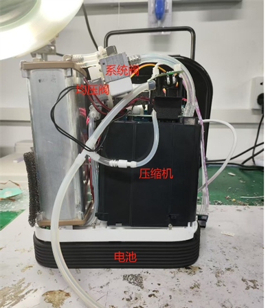
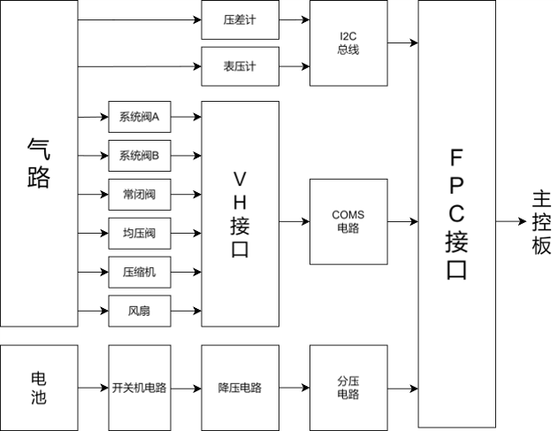
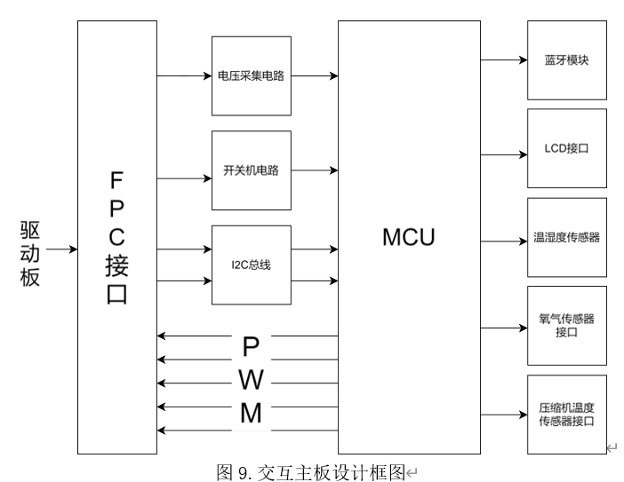
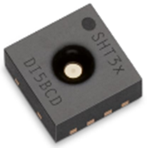
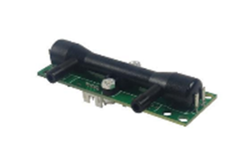
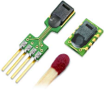
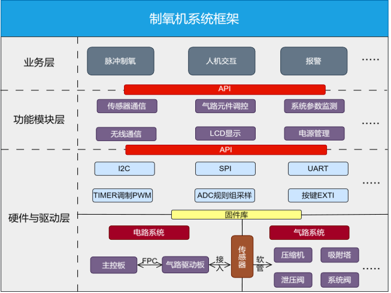

本仓库主要展示本项目的核心代码。

## 工作原理

本项目基于变压吸附原理进行制氧，工作原理如下图所示：

## 硬件实物

## 硬件实物

硬件实物如下图所示：

<table width="100%">
  <tr>
    <td width="50%" align="center"></td>
    <td width="50%" align="center"></td>
  </tr>
</table>

硬件框图如下：

<table width="100%">
  <tr>
    <td width="50%" align="center"></td>
    <td width="50%" align="center"></td>
  </tr>
</table>

## 传感器

所用传感器如下：

<table width="100%">
  <tr>
    <td width="33%" align="center"></td>
    <td width="33%" align="center"></td>
    <td width="33%" align="center"></td>
  </tr>
</table>

## 软件框图

软件框图如下：

## 测试结果

系统最终测试结果如下（参照行业标准 YY/T 0298-1998）：

| 参数 | YY/T 0298-1998 | 本系统 |
| --- | --- | --- |
| 出氧浓度 | ≥ 90% | 90%–93% |
| 流量 | — | 最大 1–2 L |
| 重量 | — | ≤ 7 kg |
| 噪音 | ≤ 85 dB | ≤ 65 dB |